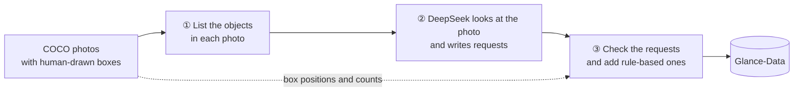

<p align="center">
  <picture>
    <source media="(prefers-color-scheme: dark)" srcset="assets/logo-dark.svg">
    
  </picture>
</p>

<h1 align="center">Glance-Data</h1>

<p align="center"><b>English</b> · <a href="README.zh-CN.md">简体中文</a></p>

<p align="center">
  A dataset for finding objects in images from a text request
</p>

<p align="center">
  <a href="https://huggingface.co/datasets/Vision-Decision/Glance-Data"></a>
  <a href="https://github.com/Vision-Decision/Glance-Data/actions/workflows/ci.yml"></a>
  
  <a href="LICENSE"></a>
  <a href="LICENSE-DATA.md"></a>
</p>

## What is this?

You give a model an image and a short text request, such as *"the two cows lying on the left"*. The model answers with
a **bounding box** (a rectangle drawn around the object) for every matching object, or says the object **is not in the
image**. This task is called *visual grounding*.

Glance-Data provides training and test data for this task. Every image comes with many requests, and every request
comes with the correct answer.

<p align="center">
  
</p>

| # | Request | Correct answer |
|---|---|---|
| 1 | the big cow eating hay | the orange box |
| 2 | the two cows lying together on the left | both blue boxes |
| 3 | a horse | not in the image |

## What kinds of requests are included?

Existing datasets such as RefCOCO mostly contain one style of request: a short English phrase that picks out a single
object. Glance-Data adds the other ways people actually ask:

| Request type | Example | Correct answer |
|---|---|---|
| Detailed description | *the large white-and-brown cow eating hay in the middle* | 1 box |
| Short or casual | *the big grazing cow* | 1 box |
| Just the object name | *the tie* (there is only one tie) | 1 box |
| All objects of a kind | *all the zebras* | 5 boxes |
| Several objects together | *the two cows lying together on the left* | 2 boxes |
| By what it is used for | *something to sit on* | every chair and sofa |
| Chinese | *左边穿黑色西装的男子* ("the man in a black suit on the left") | 1 box |
| Right object, wrong detail | *a black cow* (every cow is white and brown) | not in the image |
| Wrong number or place | *six zebras* (there are five) | not in the image |

The box positions come from COCO, a large set of photos in which people drew a box around every object. A language
model (DeepSeek) only writes the text of the requests. It never decides where the boxes are.

## Get the data

| Split | Images | Requests | Purpose |
|---|---:|---:|---|
| `train` | 24,406 | 1,831,146 | training |
| `diagnostic` | 300 | 23,578 | testing; these images are never used for training |

```python
from datasets import load_dataset

ds = load_dataset("Vision-Decision/Glance-Data")
for q in ds["train"][0]["questions"][:3]:
    print(q["text"], q["present"], q["boxes"])
```

Each row is one image, listed with its `image_id` and file name. Each request has its `text`, a `kind` (one of the
types above), `present` (whether the object is in the image) and `boxes` (`[x0, y0, x1, y1]` in pixels). The images
themselves are COCO 2014 photos and are not included.

## How the data is made



We checked quality by hand: we sampled 112 requests across all types and looked at each one against its image. About
90% were correct, and every "right object, wrong detail" request was correct.

Rule-made requests such as *six zebras* are only written when the answer is "not in the image", so a model could learn
the answer from the words alone. An optional step, `make twins`, places each of them word for word on another image
where the answer is the opposite. We call such a pair a *minimal pair*. After this step, a test that reads only the
text does no better than chance on these requests. See [docs/TWINS.md](docs/TWINS.md).

## Rebuild it yourself

```bash
uv venv && uv pip install -e ".[dev]"
cp .env.example .env            # set the data paths and your DeepSeek API key file
make pipeline SPLIT=train
```

| Folder | Contents |
|---|---|
| `glance_data/` | the code, one module per step |
| `tests/` | tests |
| `docs/` | analysis of the original data and quality-check results |
| `configs/` | settings for the minimal-pair step |
| `AGENTS.md` | data format and design rules, for contributors |

## License

The code is under [Apache-2.0](LICENSE). The data is under [CC BY-NC-SA 4.0](LICENSE-DATA.md) and is for
**non-commercial research only**, because it builds on gRefCOCO, which uses the same license. See
[LICENSE-DATA.md](LICENSE-DATA.md) for every source and how to cite it. The example photo is from COCO
([Flickr](http://farm7.staticflickr.com/6214/6266504428_369fe0f165_z.jpg), CC BY 2.0); we drew the boxes.
