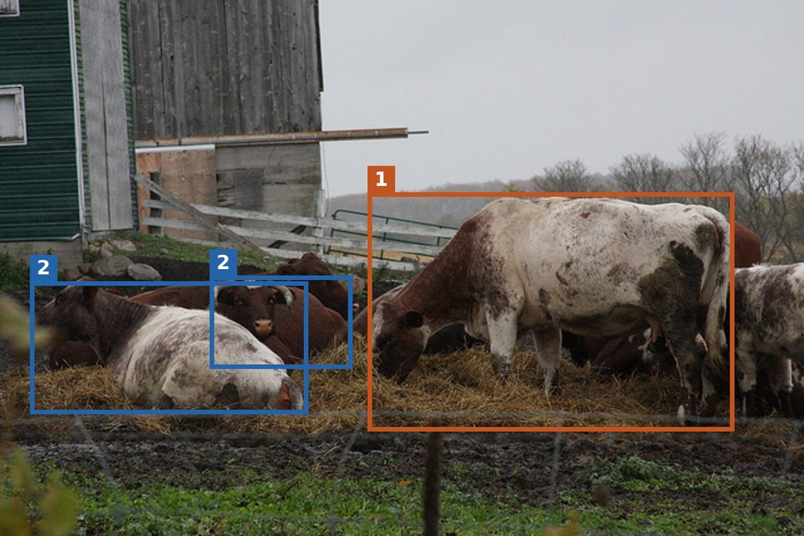
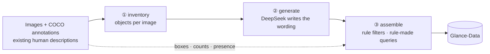

<p align="center">
  <picture>
    <source media="(prefers-color-scheme: dark)" srcset="assets/logo-dark.svg">
    
  </picture>
</p>

<h1 align="center">Glance-Data</h1>

<p align="center"><b>English</b> · <a href="README.zh-CN.md">简体中文</a></p>

<p align="center">
  <b>Exact boxes. Many ways to ask.</b><br>
  Grounding data for one image and many text requests
</p>

<p align="center">
  <a href="https://huggingface.co/datasets/Vision-Decision/Glance-Data"></a>
  <a href="https://github.com/Vision-Decision/Glance-Data/actions/workflows/ci.yml"></a>
  
  <a href="LICENSE"></a>
  <a href="LICENSE-DATA.md"></a>
</p>

<p align="center">
  
</p>

<p align="center">
  <sub><b>1</b> the big cow eating hay → 1 box　·　<b>2</b> the two cows lying together on the left → 2 boxes　·　<b>3</b> a horse → not present</sub>
</p>

---

Glance-Data extends the RefCOCO family with the requests that data is missing:

- **More ways to ask.** Each target gets short, medium and long descriptions, casual phrasing and Chinese, plus
  category-only ("the tie") and all-instance ("all the zebras") requests.
- **Saying "not present".** Hard negatives keep the category but get a detail wrong, such as "a black cow" when every
  cow is white and brown. There are also count, position and near-category negatives.
- **Several boxes at once.** Multi-target requests, and descriptions by use ("something to sit on").

Boxes, counts and whether a category is present all come straight from COCO annotations. The LLM only writes the
wording.

## Dataset

| split | images | questions | from |
|---|---:|---:|---|
| `train` | 24,406 | 1,831,146 | RefCOCO-family training images, with every benchmark image removed |
| `diagnostic` | 300 | 23,578 | held-out `refcoco_val` images, never used for training |

```python
from datasets import load_dataset

ds = load_dataset("Vision-Decision/Glance-Data")
for q in ds["train"][0]["questions"][:3]:
    print(q["kind"], q["text"], q["boxes"])
```

Each row is one image. Each question has `text`, `lang`, `kind`, `present` and `boxes`. The images are COCO 2014 and
are not redistributed.

## How it works



In a stratified human audit, about 90% of 112 sampled labels were correct, and all 16 hard negatives were correct.

## Quickstart

```bash
uv venv && uv pip install -e ".[dev]"
cp .env.example .env            # data paths and the API key file
make pipeline SPLIT=train       # inventory → generate → assemble → compare
```

| path | what |
|---|---|
| `glance_data/` | one resumable module per stage |
| `tests/` | unit tests for the rule-based logic |
| `docs/` | data diagnosis and validation results |
| `AGENTS.md` | record schema, design rules, validation protocol |

## License

The code is licensed under [Apache-2.0](LICENSE). The data is licensed under [CC BY-NC-SA 4.0](LICENSE-DATA.md), for
**non-commercial research only**, which follows the terms of the gRefCOCO source data. "Data" covers the Hugging Face
dataset, everything the pipeline produces, and `docs/results/`. Source terms and citations are in
[LICENSE-DATA.md](LICENSE-DATA.md). The example image is from COCO
([Flickr](http://farm7.staticflickr.com/6214/6266504428_369fe0f165_z.jpg), CC BY 2.0); we added the boxes.
