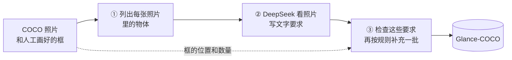

<p align="center">
  <picture>
    <source media="(prefers-color-scheme: dark)" srcset="assets/logo-dark.svg">
    
  </picture>
</p>

<h1 align="center">Glance-COCO</h1>

<p align="center"><a href="README.md">English</a> · <b>简体中文</b></p>

<p align="center">
  根据一句文字要求，在图片里找到对应物体的数据集
</p>

<p align="center">
  <a href="https://huggingface.co/datasets/Vision-Decision/Glance-COCO"></a>
  <a href="https://github.com/Vision-Decision/Glance-COCO/actions/workflows/ci.yml"></a>
  
  <a href="LICENSE"></a>
  <a href="LICENSE-DATA.md"></a>
</p>

## 这是什么？

给模型一张图片和一句文字要求，比如*“左边一起躺着的两头牛”*。模型要把每个符合要求的物体用**框**标出来（框就是围住物体的矩形）；如果图里没有这样的物体，就回答**图里没有**。这类任务叫作*视觉定位*（visual grounding）。

Glance-COCO 为这个任务提供训练和测试数据：每张图片都配有很多条文字要求，每条要求都带有正确答案。

<p align="center">
  
</p>

| # | 文字要求 | 正确答案 |
|---|---|---|
| 1 | 站着吃干草的那头大牛 | 橙色框 |
| 2 | 左边一起躺着的两头牛 | 两个蓝色框 |
| 3 | 一匹马 | 图里没有 |

## 数据里有哪些类型的要求？

RefCOCO 等现有数据集里，大多只有一种要求：用一句简短的英文，指出图中的某一个物体。Glance-COCO 补上了人们实际会用的其他问法：

| 要求类型 | 例子 | 正确答案 |
|---|---|---|
| 详细描述 | *中间那头低头吃干草的白棕花大牛* | 1 个框 |
| 简短或口语 | *那头吃草的大牛* | 1 个框 |
| 只说物体名称 | *领带*（图里只有一条） | 1 个框 |
| 某类的全部物体 | *全部斑马* | 5 个框 |
| 同时指几个物体 | *左边一起躺着的两头牛* | 2 个框 |
| 按用途描述 | *可以坐的东西* | 所有椅子和沙发 |
| 英文 | *the man in a black suit on the left* | 1 个框 |
| 物体对、细节错 | *一头黑色的牛*（牛都是白棕色的） | 图里没有 |
| 数量或位置不对 | *六只斑马*（实际是五只） | 图里没有 |

框的位置来自 COCO。COCO 是一个大型图片数据集，里面每个物体都由人工画好了框。文字要求由大模型 DeepSeek 看图写出，它只负责写文字，不决定框画在哪里。

## 获取数据

本项目在 2026-11-20 之前叫 Glance-Data，GitHub 和 Hugging Face 的旧地址都会自动跳转。Hugging Face 上的
[Glance-COCO](https://huggingface.co/datasets/Vision-Decision/Glance-COCO) 包含本流程生成的数据（`default` 配置），以及 `plus`
训练补充数据、训练器格式的记录和 `robust` 评测集。

| 部分 | 图片 | 要求 | 用途 |
|---|---:|---:|---|
| `train` | 24,406 | 1,831,146 | 训练 |
| `diagnostic` | 300 | 23,578 | 测试，这些图片从不用于训练 |

```python
from datasets import load_dataset

ds = load_dataset("Vision-Decision/Glance-COCO")
for q in ds["train"][0]["questions"][:3]:
    print(q["text"], q["present"], q["boxes"])
```

每一行对应一张图片，记录它的 `image_id` 和文件名。每条要求包含：
- `text`：要求的文字；
- `kind`：属于上表中的哪种类型；
- `present`：图里是否有这个物体；
- `boxes`：框的位置，格式为 `[x0, y0, x1, y1]`，单位是像素。

图片本身是 COCO 2014 的照片，不包含在数据集里。

## 数据是怎么做出来的



质量由人工抽查：在所有类型中抽了 112 条要求，逐条对照图片检查，约 90% 正确；“物体对、细节错”这一类全部正确。

*六只斑马*这类按规则生成的要求，只在答案是“图里没有”时才会写出来，模型光看文字就能猜出答案。可选的 `make twins` 这一步会把每一条这样的要求一字不差地放到另一张图上，而那张图上的答案正好相反。这样的两条要求叫作*最小对*。做完这一步后，只看文字、不看图片的检测在这些要求上只能做到随机水平。详见 [docs/TWINS.md](docs/TWINS.md)。

## 自己重新生成

```bash
uv venv && uv pip install -e ".[dev]"
cp .env.example .env            # 填写数据路径和 DeepSeek API key 文件的位置
make pipeline SPLIT=train
```

| 目录 | 内容 |
|---|---|
| `glance_data/` | 代码，每个步骤一个模块 |
| `tests/` | 测试 |
| `docs/` | 原始数据的分析和质量检查结果 |
| `configs/` | 最小对这一步的设置 |
| `AGENTS.md` | 数据格式和设计规则，供贡献者参考 |

## 许可

代码采用 [Apache-2.0](LICENSE)。数据采用 [CC BY-NC-SA 4.0](LICENSE-DATA.md)，**仅限非商业研究使用**，因为数据基于 gRefCOCO，而 gRefCOCO 使用同样的许可。各数据来源及引用方式见 [LICENSE-DATA.md](LICENSE-DATA.md)。示例照片来自 COCO（[Flickr](http://farm7.staticflickr.com/6214/6266504428_369fe0f165_z.jpg)，CC BY 2.0），框是我们画上去的。
