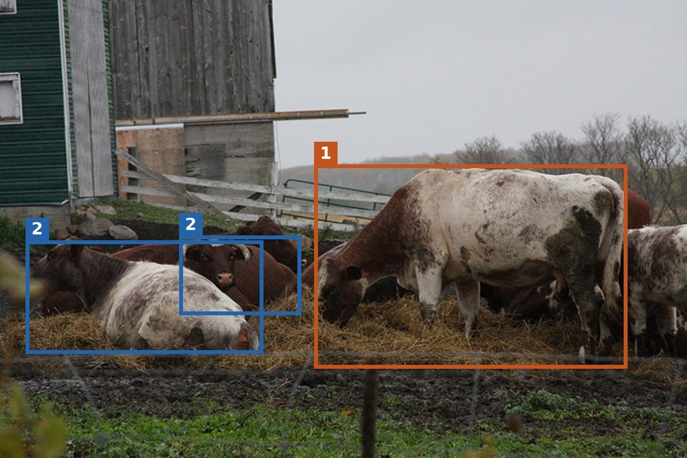
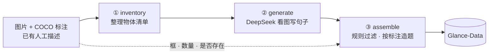

<p align="center">
  <picture>
    <source media="(prefers-color-scheme: dark)" srcset="assets/logo-dark.svg">
    
  </picture>
</p>

<h1 align="center">Glance-Data</h1>

<p align="center"><a href="README.md">English</a> · <b>简体中文</b></p>

<p align="center">
  <b>精确的框，丰富的说法。</b><br>
  一张图、多条文字需求的 grounding 数据
</p>

<p align="center">
  <a href="https://huggingface.co/datasets/Vision-Decision/Glance-Data"></a>
  <a href="https://github.com/Vision-Decision/Glance-Data/actions/workflows/ci.yml"></a>
  
  <a href="LICENSE"></a>
  <a href="LICENSE-DATA.md"></a>
</p>

<p align="center">
  
</p>

<p align="center">
  <sub><b>1</b> 站着吃干草的那头大牛 → 1 个框　·　<b>2</b> 左边一起躺着的两头牛 → 2 个框　·　<b>3</b> 一匹马 → 没有</sub>
</p>

---

Glance-Data 在 RefCOCO 系列数据的基础上，补齐原数据缺少的说法：

- **说法更多**：同一个目标有短 / 中 / 长、口语、中文几种描述，也可以只说类别名，或者要“全部”。
- **会答“没有”**：同类在、但细节不对的难负例，例如牛都是白棕色的，却问“黑色的牛”；还有数量、位置和相近类别的负例。
- **会给多个框**：一句话对应好几个目标，或者按用途描述，例如“能坐的东西”。

框、数量、某类是否存在都直接取自 COCO 标注，大模型只负责写句子。

## 数据集

| split | 图片 | 题目 | 来源 |
|---|---:|---:|---|
| `train` | 24,406 | 1,831,146 | RefCOCO 系列训练图，已移除所有评测图片 |
| `diagnostic` | 300 | 23,578 | `refcoco_val` 留出图片，从未用于训练 |

```python
from datasets import load_dataset

ds = load_dataset("Vision-Decision/Glance-Data")
for q in ds["train"][0]["questions"][:3]:
    print(q["kind"], q["text"], q["boxes"])
```

每一行是一张图，`questions` 里的每条题带有 `text`、`lang`、`kind`、`present` 和 `boxes`。图片来自 COCO 2014，不随数据集分发。

## 怎么做的



分层人工抽查 112 条，**约 90% 正确**；同类难负例 16/16 全部正确。

## 快速开始

```bash
uv venv && uv pip install -e ".[dev]"
cp .env.example .env            # 数据路径和 API key 文件的位置
make pipeline SPLIT=train       # inventory → generate → assemble → compare
```

| 目录 | 内容 |
|---|---|
| `glance_data/` | 每个阶段一个模块，都可以断点续跑 |
| `tests/` | 规则部分的单元测试 |
| `docs/` | 数据诊断和验证结果 |
| `AGENTS.md` | 数据格式、设计约束、验证流程 |

## 许可

代码采用 [Apache-2.0](LICENSE)。数据采用 [CC BY-NC-SA 4.0](LICENSE-DATA.md)，**仅限非商业研究**，与原数据 gRefCOCO 的协议保持一致；包括 HF 数据集、pipeline 的产出和 `docs/results/`。各来源的协议和引用见 [LICENSE-DATA.md](LICENSE-DATA.md)。示例图片来自 COCO（[Flickr](http://farm7.staticflickr.com/6214/6266504428_369fe0f165_z.jpg)，CC BY 2.0），框是我们加上的。
